<div align="center">



<br/>

[](https://python.org)
[](#)
[](#-reproduce-from-scratch)
[](#)
[](#)
[](https://yurak-uz.streamlit.app)

**Cardiovascular risk prediction platform for Uzbekistan.**
<br/>
*Neural network from scratch · Clinical validation · Explainable AI · HL7 FHIR R4 export*

</div>

---

## What It Does

**Yurak** ("heart" in Uzbek) predicts **10-year coronary heart disease risk** and screens for **diabetes** using a multi-task neural network built entirely in NumPy — no sklearn, no PyTorch, no TensorFlow. Every weight, gradient, and activation is computed from first principles.

The clinical pipeline combines the neural network's predictions with the **D'Agostino 2008** analytical formula, **WHO mortality tables for Uzbekistan** (2023), and **ESC/WHO clinical guidelines** to produce actionable, personalized health recommendations ranked by impact.

---

## What You Enter, and Why

Built for a person, not only a clinician: **blood tests are optional**. Every field changes at least one result (checked on the trained model by moving each marker from a typical low to a typical high value).

| Field | Heart risk | Diabetes risk | Heart age |
|:---|:---:|:---:|:---:|
| Age, sex | ✓ | ✓ | ✓ |
| Upper (systolic) pressure, BP medication | ✓ | ✓ | ✓ |
| Lower (diastolic) pressure | ✓ weak | — | — |
| Height & weight (BMI) | ✓ | ✓ | ✓ if no cholesterol |
| Total cholesterol — optional | ✓ | ✓ | ✓ |
| HDL — optional, defaults to 1.16 mmol/L | — | — | ✓ |
| Fasting glucose — optional (≥ 7.0 mmol/L counts as diabetes) | ✓ | ✓ | ✓ |
| Diagnosed diabetes | — | — | ✓ |
| Cigarettes per day | ✓ | — | ✓ |
| Early heart disease in parents/siblings | note for the doctor | | |

- **No blood test?** Heart age switches to the D'Agostino 2008 *office (BMI) model* — coefficients and the reference person (SBP 125, BMI 22.5) verified against framinghamheartstudy.org; the network receives training medians, exactly how missing values were imputed in training. Unknown values never appear as "risk factors" and are never exported to FHIR.
- **Red flags first:** BP ≥ 180/110, fasting glucose ≥ 7.0 mmol/L without a diagnosis, total cholesterol ≥ 7.5 mmol/L and BMI ≥ 40 show a warning before any score, and every result ends with a plain *what to do next* plus heart-attack/stroke signs (ambulance **103**).
- **Not for everyone:** after a heart attack/stroke, or outside ages 32–70, the app shows guidance and the markers table instead of numbers the models can't support.

---|:---:|:---:|:---:|
| Age, sex | ✓ | ✓ | ✓ |
| Upper (systolic) pressure, BP medication | ✓ | ✓ | ✓ |
| Lower (diastolic) pressure | ✓ weak | — | — |
| Total cholesterol | ✓ | ✓ | ✓ |
| HDL — optional, defaults to 1.16 mmol/L | — | — | ✓ |
| Fasting glucose (≥ 7.0 mmol/L counts as diabetes) | ✓ | ✓ | ✓ |
| Diagnosed diabetes | — | — | ✓ |
| Height & weight (BMI) | ✓ | ✓ | — |
| Cigarettes per day | ✓ | — | ✓ |

The life estimate is derived only from heart age via WHO tables, so height and weight do not change it.
**Removed:** resting heart rate (moved risk by < 1.6 pp, in the wrong direction; fixed at the 70 bpm reference) and the stroke question — people who already had a heart attack or stroke get a referral instead of numbers, because these models are built for primary prevention.

---

## Architecture

<div align="center">


</div>

---

## Validated Metrics

Every number below is produced by an automated validation script on a held-out test set (*N* = 636), with no hardcoded constants:

| Target | Yurak Neural Net | Baseline LogReg | Reference (D'Agostino 2008) | Brier Score |
|:---|:---:|:---:|:---:|:---:|
| **10-year CHD risk** | **0.675** [0.607, 0.735] | 0.698 [0.638, 0.758] | 0.700 [0.641, 0.760] | **0.1210** |
| **Diabetes screening** | **0.884** [0.738, 0.998] | 0.827 | — | **0.0242** |

<details>
<summary><strong>Operating Characteristics at Clinical Thresholds</strong></summary>
<br/>

| Threshold | Sensitivity | Specificity |
|:---|:---:|:---:|
| **10% (Intermediate risk)** | 75.26% | 53.62% |
| **20% (High clinical risk)** | 40.21% | 82.56% |

</details>

---

## Key Capabilities

<table>
<tr>
<td width="50%" valign="top">

### 🧠 Neural Network (Pure NumPy)
Multi-task MLP with Swish activation, Dropout regularization, and Adam optimizer. No ML frameworks — every operation hand-coded for educational transparency.

### 🔬 Explainable AI
Integrated Gradients computes each factor's contribution in percentage points relative to a healthy reference of the same age and sex.

### 💊 Personalized Recommendations
Clinical guidelines (WHO/ESC) merged with neural network delta simulations: steps ranked by risk reduction magnitude.

</td>
<td width="50%" valign="top">

### ❤️ Cardiovascular Age
Closed-form D'Agostino 2008 formula. Critical bug in the original codebase (constant collapse) identified and fixed.

### 📊 WHO Life Tables
Official 2023 demographic grid for Uzbekistan with vascular age correction for life expectancy estimation.

### 📦 Interoperability
One-page A4 PDF report + HL7 FHIR R4 bundle with verified LOINC codes. Unit converter: mmol/L ⇄ mg/dL.

</td>
</tr>
</table>

---

## Quick Start

```bash
# Clone and install
git clone https://github.com/James0010101/Yurak.git
cd Yurak
python -m venv venv && venv\Scripts\activate  # Windows
pip install -r requirements.txt

# Launch
streamlit run streamlit_app.py
```

The app opens at `http://localhost:8501`.

---

## 🔬 Reproduce From Scratch

Any researcher can reproduce training and validation in 4 commands:

```bash
python scripts/prepare_data.py          # Stratified split 70/15/15
python scripts/fetch_who_life_table.py  # WHO mortality tables for Uzbekistan
python scripts/train_model.py           # Train neural network, compute ROC-AUC with CI
pytest -q                               # Run all 59 automated tests
```

---

## Repository Structure

```
Yurak/
├── streamlit_app.py            # Main entry: config, i18n, st.navigation
├── neural_network.py           # Pure NumPy MultiTask MLP (Swish, Dropout, Adam, IG)
├── app_pages/
│   ├── screening.py            # Risk form, metrics, top-3 actions, XAI, export
│   ├── methodology.py          # Loss curves, ROC-AUC, calibration
│   └── about.py                # Project context, roadmap
├── core/
│   ├── clinical.py             # D'Agostino 2008, Heart Age, WHO tables
│   ├── risk_model.py           # Inference, Integrated Gradients, simulations
│   ├── recommendations.py      # Clinical rules + neural net delta ranking
│   ├── report.py               # PDF report + HL7 FHIR R4 bundle
│   ├── units.py                # mmol/L ⇄ mg/dL bidirectional conversion
│   └── ...                     # config, i18n, thresholds
├── scripts/                    # Data prep, WHO fetch, training
├── tests/                      # 59 automated tests (clinical, ML, XAI, UI)
├── data/                       # Framingham dataset, WHO tables
├── models/                     # Weights, metrics, model card
└── i18n/                       # ru.json, uz.json, en.json
```

---

## Medical & Legal Disclaimer

Yurak is a **research and educational prototype**. It is intended for primary risk stratification and public health awareness. It **does not replace a physician consultation**, does not make final clinical diagnoses, and does not prescribe medication.

---

<div align="center">
<sub>Built by <a href="https://github.com/James0010101">Jahongir Sadullayev</a> · Tashkent, Uzbekistan 🇺🇿</sub>
</div>
